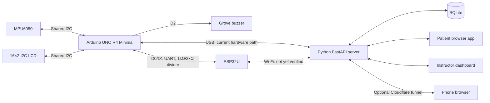

# SmartRep · Scan & Lift

An ECE 198 exercise-tracking prototype that connects a motion sensor to a patient
app, a clinician dashboard, and local LCD/buzzer feedback.

Patients select their prescribed exercise, complete a calibrated set, and review
results. Instructors establish movement references and monitor progress. Saved
exercise history and graph samples can be downloaded as Excel workbooks.

> **Current status:** the app, simulator, live-input graphs, LCD connection and D2
> buzzer test are available. The attached MPU returns changing inputs but has also
> shown intermittent read failures and an unusual ID. Physical rep accuracy remains
> unverified. ESP32 Wi-Fi firmware is uploaded, but the wall-power test did **not**
> connect to the server; the ESP32U has no external antenna fitted. Use USB for the
> current hardware demonstration. This project uses fictional patient records.

## Features

| Feature | What it does | Status |
|---|---|---|
| Patient exercise app | Station selection, prescribed sets, live counts, feedback and summaries | Implemented; simulator walkthrough verified |
| Instructor dashboard | Patient progress, station availability and status alerts | Implemented |
| Teacher calibration | Three reference movements, live graphs, detected-cycle counter and saved reference | Implemented; real sensor reads must succeed |
| Rep detection | Calibrated range, hysteresis, timing and good/short/rushed/slow feedback | Software-tested; physical accuracy still needs measurement |
| LCD feedback | Patient name, completed reps, calibration progress and result | LCD detected and text observed |
| Grove buzzer on D2 | Short tone for counted reps; one-second manual test | Manual D2 tone heard; full physical rep sequence not verified |
| Live MPU diagnostics | Acceleration/gyro graphs, raw numbers/bytes, pause, clear and CSV download | Live changing inputs observed; read failures are displayed |
| Excel exercise history | Patient details, all saved sets/reps, recorded graph data and calibrations | Implemented and software-tested |
| Phone access | Responsive browser app, temporary Cloudflare link and QR launcher | Implemented; laptop must remain awake |
| Simulator | Five stations, example patients, room simulation and movement patterns | Working software demonstration without hardware |
| Persistent history | SQLite records, reconnection snapshots and abandoned-set recovery | Software-tested |
| ESP32 wireless transport | Bidirectional UART ↔ Wi-Fi WebSocket bridge | Firmware uploaded; end-to-end wall-power connection not verified |
| Expo companion | Optional React Native client and exported web preview | Included; primary demonstration uses the browser app |

Short attempts do not increment completed reps. Full rushed movements count with a
warning. The graph and count are relative to the saved exercise reference; this
system does not measure absolute displacement or independently establish correct form.

## System overview



**Wall power replaces USB power, not the server.** Both boards can receive USB wall
power, but wireless operation also needs a working ESP32 link and the running
laptop server on a reachable network.

## Quick start on the existing Mac

1. Plug the Arduino into the Mac with a USB data cable. Close Arduino Serial Monitor.
2. In Finder, open the project folder and double-click **Start SmartRep.command**.
3. The launcher starts normal full-range hardware mode, opens a phone link and
   displays a QR code. Keep its Terminal window open and the laptop awake.
4. Use the link or QR on your phone. Press **Control+C** in Terminal to stop the
   processes started by the launcher. Each launch may create a new phone URL.

For laptop-only full-range use, double-click **start-smartrep-hardware.command**; it does
not need Cloudflare. Open [SmartRep](http://127.0.0.1:8000/app).

| Launcher | Purpose | Database |
|---|---|---|
| `Start SmartRep.command` | Full-range hardware + phone link/QR | `bridge/smartrep-hardware.db` |
| `start-smartrep-small-demo.command` | Small-movement hardware, local/LAN access | `bridge/smartrep-small-demo.db` |
| `start-smartrep-hardware.command` | Normal-range hardware mode | `bridge/smartrep-hardware.db` |
| `start-smartrep.command` | Five simulated stations and example activity | `bridge/smartrep-demo.db` |

Run **one server launcher at a time**. A port-in-use message means another server
is already using port 8000. Simulation, normal hardware and small-movement mode
use separate databases. Do not use simulated calibration for the physical sensor.

## Setup on another computer

### 1. Install the Python server

Clone this private repository using an account with access. Python 3.12 is the
verified setup version. From the repository root on macOS/Linux:

```sh
cd bridge
python3 -m venv .venv
source .venv/bin/activate
python -m pip install -r requirements-lock.txt
python -m pip install -e '.[test]'
```

On Windows PowerShell:

```powershell
cd bridge
py -3.12 -m venv .venv
.\.venv\Scripts\python.exe -m pip install -r requirements-lock.txt
.\.venv\Scripts\python.exe -m pip install -e ".[test]"
```

The `.command` launchers are for macOS. On Windows, run the equivalent Python
command below with `.\.venv\Scripts\python.exe`.

### 2. Choose a mode

Run these from `bridge/` with the virtual environment active:

```sh
# No hardware needed
python -m smartrep --simulate --crowd --db smartrep-demo.db

# Physical sensor, normal calibration range
python -m smartrep --db smartrep-hardware.db

# Small-movement classroom demonstration
python -m smartrep --small-movement-demo --db smartrep-small-demo.db
```

Choose one command. The server prints its local/LAN addresses. Use
`--http-port 8001` if a different port is needed, or `--port /dev/cu.usbmodemXXXX`
(`--port COM4` on Windows) to specify a serial port.

Restarting preserves saved history. `--reset-db` deletes the selected database;
use a new `--db` filename when you want an independent run without deleting records.

### 3. Open the app

| Page | Local address |
|---|---|
| Welcome screen | [localhost:8000](http://127.0.0.1:8000/) |
| Patient app | [localhost:8000/app](http://127.0.0.1:8000/app) |
| Instructor dashboard | [localhost:8000/dashboard](http://127.0.0.1:8000/dashboard) |
| Live MPU diagnostics | [localhost:8000/diagnostics](http://127.0.0.1:8000/diagnostics) |
| API documentation | [localhost:8000/docs](http://127.0.0.1:8000/docs) |

The default example patient is **Mary**, ID **123129**. The demo staff PIN is **0000**.

## Hardware setup

### Parts and connections

Current station: **UNO R4 Minima + Grove Base Shield + MPU6050 breakout + standard
I2C-backpack LCD + Grove buzzer v1.2**. The older MMA7361 and Grove RGB LCD sketches
remain separate variants; do not flash them onto the current station.

Disconnect power before changing connections. Use a shared GND.

| Component | Arduino / breadboard connection |
|---|---|
| LCD VCC / GND | 5V / shared GND |
| LCD SDA / SCL | Dedicated Arduino SDA / SCL |
| MPU GND | Shared GND |
| MPU SDA / SCL | Same SDA / SCL bus as LCD |
| MPU VCC | Supply appropriate for the actual breakout; a regulated GY-521 commonly accepts 5V |
| Grove buzzer | Shield socket **D2** |
| ESP32 GPIO17 / TX2 | Arduino D0 / RX |
| Arduino D1 / TX | Through the divider below to ESP32 GPIO16 / RX2 |
| ESP32 GND | Shared GND |

```text
Arduino D1/TX ── 1 kΩ ──┬── ESP32 GPIO16/RX2
                        │
                       2 kΩ
                        │
                       GND
```

Do not put Arduino 5V directly on an ESP32 GPIO or power the ESP32 from Arduino
3.3V. Power each board through its own USB connector. Disconnect UART signal wires
when testing with one board unpowered. Confirm MPU supply and SDA/SCL voltage
compatibility on the actual breakout: a VCC regulator alone does not make its signal
pins 5V tolerant. Leave MPU AD0/INT/XDA/XCL unused for the basic setup.

### Upload firmware

In Arduino IDE, install **Arduino UNO R4 Boards**, **esp32 by Espressif Systems**,
**hd44780 by Bill Perry**, and **WebSockets by Markus Sattler** as needed.
The checked compiler versions are Renesas UNO **1.6.0** and ESP32 core **2.0.17**.

| Board selection | Sketch |
|---|---|
| Arduino UNO R4 Minima | `firmware/smartrep_mpu6050_lcd_wifi/smartrep_mpu6050_lcd_wifi.ino` |
| ESP32 Dev Module | `firmware/smartrep_esp32_wifi/smartrep_esp32_wifi.ino` |

The UNO uses 50 kHz I2C, 50 Hz normal sampling, USB Serial and hardware Serial1.
Both UART ends use **115200 baud, normal polarity**. The current firmware uses D2
for the buzzer and retains independent USB and ESP32 connections.

Firmware **1.2.0** treats the attached board as an MPU6050 at the project owner's
request. Its unusual identity is informational, not an initialization gate.
Configuration writes and a complete sensor read must still succeed. This choice
does not establish the chip's true identity or measurement accuracy.

### Optional ESP32 Wi-Fi

1. Fit the ESP32U's external 2.4 GHz antenna and verify the UART divider/wiring.
2. Copy `firmware/smartrep_esp32_wifi/config.example.h` to `config.h` in that folder.
3. Enter the Wi-Fi name/password and set `BRIDGE_HOST` to the laptop's **local IP**
   on that network. `smartrep.local` is a fallback if multicast discovery works.
4. Upload to the ESP32 via USB. Hold BOOT during connection if upload requires it.
5. Run the server on the laptop and confirm `/api/devices` reports `link: wifi` and
   healthy UART/sensor status before removing USB data connections.
6. Only then move both boards to USB wall adapters and repeat a set.

`config.h` is ignored by Git. Never commit Wi-Fi passwords. The Cloudflare phone URL
is **not** the ESP32's server address. A school browser-login network is not supported
by this firmware; use a reachable 2.4 GHz hotspot instead.

**Observed status:** the ESP32 was flashed, but the wall-power test showed no online
Wi-Fi device. The antenna is absent and the UART/network path has not been validated.
Wireless remains an included feature requiring completion, not a demonstrated success.

## Patient and instructor workflow

1. **Inspect hardware:** Staff setup → **Check live MPU inputs**. Tilt the sensor
   and watch raw acceleration/gyro values. **Test buzzer · D2** sends a one-second
   tone. Close diagnostics afterward to release the station.
2. **Calibrate:** Staff setup → ID `123129` → PIN `0000` → **Bicep curl**. Hold still
   briefly, complete three controlled movements, return to the starting position,
   then save. Save unlocks when the shared validator captures three complete
   cycles. Those samples are frozen, so reaching for Save cannot change the count.
   Missing readings fail clearly after five seconds; close or retry after fixing
   the connection. Closing calibration cancels it and releases the station.
3. **Exercise:** Scan a station → **Dumbbells · 5 lb → Bicep curl → Start set**.
   The app and LCD show the patient name/count; counted reps trigger a short D2 tone.
4. **Review:** Finish the set, inspect feedback, and open the instructor dashboard.
5. **Export:** Select **Download Excel** in patient activity or patient details.

Secure the sensor firmly and recalibrate after changing its position or exercise.
Small-movement mode accepts a lower calibration range; it does not measure a 5 cm
distance. If reads fail, resolve the connection before expecting reliable rep counts.

The standalone diagnostic page reserves the device, so sets/calibrations cannot
compete for it. Its CSV contains raw diagnostic inputs. Patient Excel downloads
include **Patient, Sets, Reps, Graph data, Calibration** sheets. Graph recording
starts with the logging update; older waveforms were not stored. Times are UTC.

## Use a phone

For a temporary Internet phone link, install **cloudflared** using its
[official installation instructions](https://developers.cloudflare.com/cloudflare-one/connections/connect-networks/downloads/),
then use **Start SmartRep.command**. The launcher can also use the existing ignored
`.local/cloudflared` binary on this Mac. This binary is not included in the repository.

For LAN access, join the laptop and phone to a network that allows devices to reach
one another, then open the laptop's printed IP and port. `127.0.0.1` on the phone
refers to the phone itself. If school DNS blocks a temporary Cloudflare name, mobile
data may work for phone access. The laptop server must stay awake either way.

For the optional Expo client, install Node.js and an Expo Go version compatible with
the pinned SDK, then run `npm ci` and `npm start` from `app/`. The Expo development
QR opens the client; the bridge QR supplies its server address. The primary demo
requires only the browser, not Expo. See `app/package.json` for build/typecheck scripts.

## Reliability and validation

The processing pipeline includes unit conversion, gyro bias estimation, complementary
orientation filtering, EMA smoothing, calibrated hysteresis and minimum-cycle rules.
Sample gaps reset partial motion; calibration gaps require a retry. Rep results are
saved before their live events are sent. Reconnection restores saved counts, and
shutdown/restart recovery retains completed history.

```sh
cd bridge
.venv/bin/python -m pytest -q
```

The latest run passed 78 backend tests and seven browser-logic checks.
The calibration regression suite covers partial returns, competing motion axes,
extra motion after capture, sensor gaps, invalid readings, missing data, concurrent
Save/Cancel, reconnect status and station release after transport failures.
Run browser logic checks from the repository root:

```sh
node --test bridge/tests/browser/*.test.cjs
```

The UNO sketch version 1.2.1 also preserves the detected MPU I2C address for raw
reads (0x68 or 0x69). Upload it separately if updating the board; server changes do
not flash firmware. Compilation and synthetic tests do not establish physical rep
accuracy, radio range or repeatable wall-power operation.

For a meaningful physical demonstration, compare three trials of 10 manually counted
reps, check rest/partial/rushed movements, compare tilt against a rough known-angle
reference, and test disconnect/restart recovery. Record actual results rather than
assuming success from changing graphs. See the complete [verification record](docs/VERIFICATION.md).

## Troubleshooting

| Symptom | Check |
|---|---|
| Serial port busy | Close Arduino Serial Monitor, recorders, and any other server |
| Sensor errors or several-second pauses | Check short SDA/SCL wires, shared GND, power and read failures; the firmware retries initialization every two seconds |
| LCD lights but has no text | Confirm I2C wiring and slowly adjust the backpack contrast screw |
| No buzzer sound | Confirm the cable is in **D2**, fully seated at both ends; use the diagnostic tone button |
| Station in use | Close diagnostics or finish the active set/calibration |
| Ask staff to set up | Calibrate the same patient/exercise with the mounted sensor |
| ESP32 offline | Check antenna, both boards' power, UART divider, hotspot credentials and laptop IP |
| Phone link stopped working | Relaunch the tunnel; temporary links change and depend on the laptop |
| Cannot save a reference | Read the reported range, timing, gap or sensor error and retry after fixing it |

## Presentation and symposium

The [readiness checklist](docs/SYMPOSIUM_READINESS.md) maps the supplied course handout
to implemented features, system/software diagrams, testing, safety, limitations and
remaining physical work. It includes an eight-minute presentation outline, rough
accuracy-comparison procedures, acknowledgements, bibliography and AI disclosure.
Slides, recording/submission, neat wiring and attendance still need the team's work.

This prototype may help demonstrate exercise adherence and instructor feedback;
clinical effectiveness has not been evaluated. It does not diagnose conditions,
measure muscle effort or independently prescribe treatment. Use fictional data:
the demo PIN and participant IDs are not production authentication or privacy controls.

**AI disclosure:** OpenAI Codex assisted with implementation, debugging, tests and
documentation. The team should review and understand the submitted work and identify
which physical tests it personally performed. Library/platform acknowledgements and
primary references are listed in the readiness checklist.

## Repository map

```text
bridge/smartrep/       API, sensor transport, filtering, calibration, counting, exports
bridge/static/        Patient app, instructor dashboard, live diagnostic page
bridge/tests/         Software and protocol tests
firmware/             Current UNO/ESP32 sketches and older hardware variants
app/                  Optional Expo client
tools/                Phone launcher, hardware checks, recording and QR utilities
docs/                 Wiring, verification and presentation readiness
output/               Existing QR labels and hardware handoff guides
```

Local environments, databases, recordings, Wi-Fi secrets and temporary tunnel files
are excluded from Git. The earlier inverting-transistor guide is archived;
[MPU_ESP32_QUICK_START.md](docs/MPU_ESP32_QUICK_START.md) describes the current wiring.
