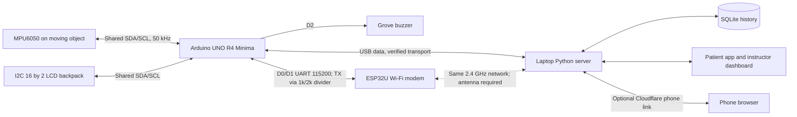
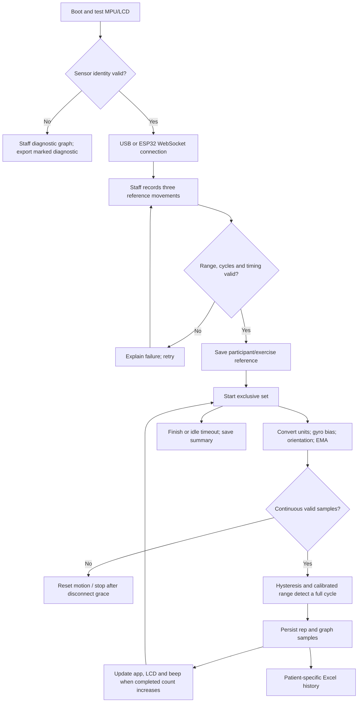

> **Final policy update:** firmware 1.2.0 treats the attached board as an MPU6050
> at the owner's request. Identity mismatches are informational; configuration/read
> failures still block operation. Earlier identity-gating descriptions below are
> historical. Real count/angle accuracy has not been established by this change.

# Final presentation and symposium readiness

This checklist maps the supplied **Final Presentation and Symposium Info.docx**
to the current repository. Presentation and physical assembly requirements cannot
be satisfied by code alone. This is a student demonstration with fictional patient
records, not a validated medical device or clinical decision system.

## Requirement coverage

| Handout requirement | Project evidence | Remaining work |
|---|---|---|
| Impact and selected problem | Participant guidance, rep feedback, clinician progress dashboard and Excel history | Explain intended benefit; no clinical outcome study has been conducted |
| Physical system/block diagram | Diagram below, current wiring in MPU_ESP32_QUICK_START.md | Photograph and label the actual assembled prototype |
| Software/system logic | Flow below; units.py, orientation.py, reps.py, calibration.py, session.py | Demonstrate with the chosen hardware mode |
| Testing and validation | Automated tests, VERIFICATION.md, test_mpu_station.py, comparison procedure below | Resolve MPU identity and complete repeatable physical trials |
| Functional reliability | Parser validation, sensor checks, heartbeat/reconnect, gap handling, saved history, timeout handling | Repeated physical reset/disconnect and power tests; no single-run claim |
| Wiring neatness, layout and resistors | Pin map and UART divider values documented | Check actual resistor values, common GND, strain relief and enclosure |
| Readable code, comments, errors | Comments explain protocol, wiring and non-obvious signal handling; tests cover failures | Team should understand and be able to explain the implementation |
| Ease of use | Double-click launcher, phone QR, staff setup, LCD name/count, beep, history download | Practice startup without coding assistance; keep USB fallback ready |
| Patient and clinician safety | Counts require calibration, short attempts excluded, faults do not become validated reps | Supervised unloaded demonstrations; no automatic prescription changes |
| Measurement accuracy | Deterministic synthetic reference tests and comparison procedure below | Real count/angle accuracy is not established |
| Limitations and improvements | Explicit list below and live diagnostic warning | Discuss current sensor ID and absent antenna honestly |
| Noise handling | EMA, gyro bias estimate, complementary orientation filter, hysteresis, min-cycle/gap rules | Quantify real noise and mounting sensitivity |
| Issues encountered | Reversed supply damaged an earlier sensor; later MPU responds with unexpected ID; school captive portal; absent ESP32U antenna | Explain evidence and corrective work, without claiming unresolved issues solved |
| Clear slides, labels, acknowledgements, bibliography, AI disclosure | Suggested material below | Create and review the actual slides/video |
| Eight-minute prerecorded presentation | Suggested timed outline below | Record and upload to Learn by the handout deadline |
| Symposium presentation on laptop and ability to answer questions | USB hardware path, separate simulation and readiness checklist | Attend assigned section and demonstrate the actual working scope |
| Creativity and engineering rigor rubric | Integration of sensing, per-person calibration, local feedback, instructor view and traceable exports | Creativity is assessed by instructors; document strengths and shortcomings |

## Physical system

Each board has its own USB supply and a shared GND. The ESP32 is not powered from
Arduino 3.3V. The current ESP32U has no external antenna fitted, so its wireless path
is pending. Wall power does not host the app; the laptop must remain running.
MPU breakout supply and SDA/SCL voltage compatibility must be checked on the actual
board; an onboard VCC regulator alone does not guarantee 5V-tolerant signal pins.

## Software flow

Diagnostic frames never authorize a movement reference or a completed exercise rep.
A changing raw graph establishes changing device replies, not correct identity,
scale, angle accuracy or exercise accuracy. Simulation is explicitly labelled and
its references cannot authorize the real device. The small-movement demo lowers
calibration range requirements and is labelled separately from full exercise testing.

## Repeatable validation procedure

Keep a dated record of board, firmware revision, mounting, exercise, mode and
observations. Use an unloaded object and supervised movement for bench testing.

1. **Power and bus:** verify labelled power pins, common GND, SDA/SCL routing and
   actual divider resistor values before connecting power. Scan LCD and sensor;
   verify expected identity, not merely the power LED or address acknowledgement.
2. **Outputs:** send `TEST` using test_mpu_station.py. Confirm LCD text and one D2
   beep physically. Software can detect the LCD bus response but cannot hear a beep.
3. **Stillness:** record 10 seconds at rest. Record observed variation; no motion
   should invent reps. Do not invent a measured noise value.
4. **Rough angle reference:** after the MPU ID/configuration passes, compare the
   displayed pitch/roll with a stationary level/protractor at 0, 30, 60 and 90 degrees
   in the calibrated movement plane. Record reference, reading and absolute error.
   This is a rough bench comparison, not clinical validation. Dynamic acceleration
   and mounting errors can affect tilt estimates.
5. **Count reference:** manually count 10 slow full movements in three independent
   trials. Record manual count, app completed count, LCD count, beeps and short/rushed
   labels. Count error = app count minus manual count. Report each trial and mean
   absolute count error; do not call one successful trial proof of reliability.
6. **Boundary cases:** repeat with partial movements, pauses at the top, inverted
   mounting followed by recalibration, small motions and intentionally rushed motions.
   Short attempts should not increment completed count; fast full movements are counted
   but labelled rushed. Recalibrate after moving the mounting.
7. **Faults:** unplug a signal cable with power off, then power on to test missing
   sensor handling. Test USB interruption, bridge restart, phone reconnect and lost
   samples. Confirm existing counts remain saved and partial motion is not reused.
8. **Persistence/export:** finish a set, restart the app, download Excel for two
   different patients. Check saved counts, timestamps and graph rows; ensure one
   patient's download does not contain another's history. Diagnostic rows are flagged.
9. **Wireless and wall power:** only after an antenna and UART levels are confirmed,
   verify `/api/devices` says `link: wifi` and healthy UART/sensor/LCD. Move both boards
   to USB wall adapters, leaving the laptop server and hotspot running. Repeat three
   count trials. This test has **not** been completed on the current hardware.

Suggested trial log:

| Date/firmware | Trial/mode | Manual reps | App reps | LCD reps | Beeps | Error | Notes |
|---|---|---:|---:|---:|---:|---:|---|
| To measure | 1 / normal hardware | 10 | — | — | — | — | Pending sensor identity fix |
| To measure | 2 / normal hardware | 10 | — | — | — | — | Pending |
| To measure | 3 / normal hardware | 10 | — | — | — | — | Pending |

## Limitations and design choices

- The device estimates movement cycles and relative orientation, not absolute
  displacement, muscle effort, diagnosis or complete exercise form. A 5 cm movement
  is not a distance measurement. MPU yaw lacks an absolute reference.
- A stable attachment and separate per-person/per-exercise calibration are required.
  Gravity-only acceleration and dynamic acceleration can be confused; the gyro and
  filter help but do not prove correct form.
- The present sensor returns an unexpected WHO_AM_I value. Raw inputs change, but
  real calibration and rep validation remain blocked. Never remove the identity
  check just to make the demonstration appear successful.
- The current station's wireless modem is compiled but not uploaded or physically
  validated. It requires an external antenna and supported Wi-Fi network. School
  browser-login Wi-Fi is not handled by this firmware.
- Long I2C wires and mixed-voltage pull-ups can affect reliability. The code uses
  50 kHz I2C, timeouts and bounded recovery; those do not replace a correct circuit.
- This demo uses fictional patient records and a demo staff PIN, without production
  authentication or clinical privacy controls. Do not put real patient data online.
- Historical sets/reps are retained. Graph data begins with the recording update;
  older waveforms are unavailable. Sampling for graph history is throttled to 10 Hz.
- Suggested future work: identify/replace the MPU, verify voltage levels, add antenna,
  measure accuracy across trials, validate mounting and movement types, then add
  production authentication/hosting only if the intended use requires it.

## Presentation material

An eight-minute outline: problem/user and intended impact (1 minute); physical system
and circuit choices (1.5); software flow and calibration (1.5); demonstrated features
(1); test evidence and measured results (1.5); limitations and next steps (1); sources
and AI disclosure (0.5). Use legible labelled diagrams and show which paths were
physically tested. Include the actual prototype presentation on the symposium laptop.

The supplied handout says upload the prerecorded presentation by **Sunday November 22**
and lists symposium sessions during the week of November 23. Confirm the assigned
section and Learn instructions; no submission or attendance is performed by this code.

Acknowledgements should name actual teammates and assistance only; fill these in
before recording. Cite the course handout, sensor documentation, Arduino/Espressif
APIs and libraries used. Useful primary references:

- MPU6050 register map: https://invensense.tdk.com/wp-content/uploads/2015/02/MPU-6000-Register-Map1.pdf
- Arduino UNO R4 Minima: https://docs.arduino.cc/hardware/uno-r4-minima/
- ESP32 serial API: https://docs.espressif.com/projects/arduino-esp32/en/latest/api/serial.html
- hd44780 LCD library: https://github.com/duinoWitchery/hd44780
- WebSockets library: https://github.com/Links2004/arduinoWebSockets

Suggested AI disclosure to review and adapt truthfully:

> OpenAI Codex assisted with software implementation, debugging, test development and
> project documentation. The team must review and understand the submitted work and
> identify which hardware tests it personally performed. Automated/synthetic results
> are distinguished from physical measurements; no unperformed validation is claimed.
